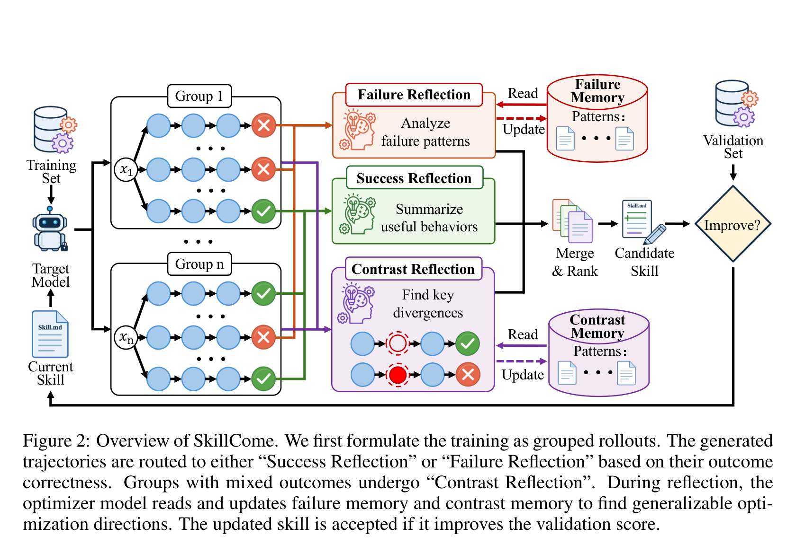

# SkillCome: Group Contrast Skill Optimization with Dual Memory

<p align="center">
  <a href="https://arxiv.org/abs/2609.37128"></a>
  <a href="LICENSE"></a>
</p>

This is the official code repository for our paper
**SkillCome: Group Contrast Skill Optimization with Dual Memory**.

## Overview

SkillCome optimizes reusable natural-language skills from grouped agent
rollouts. Instead of reflecting on trajectories independently, it compares
successful and failed executions of the same task to identify the behavioral
differences that determine success. Two persistent memories carry these
findings across optimization steps.

<p align="center">
  
</p>

## Environment

SkillCome requires Python 3.10 or later. Create an environment and install the
package with:

```bash
python -m venv .venv
source .venv/bin/activate
pip install -e '.[dev]'
```

Copy the environment template and configure an OpenAI-compatible endpoint:

```bash
cp .env.example .env
```

Set `OPENAI_API_KEY` and `OPENAI_BASE_URL` in `.env`. `TARGET_MODEL` and
`OPTIMIZER_MODEL` may be set to different model identifiers.

For ALFWorld, install the optional text-environment dependencies:

```bash
pip install -e '.[alfworld]'
```

## Dataset

Prepared benchmark splits are provided under [`data/`](data/). The table below
describes the released SkillCome configurations rather than the full upstream
corpora.

ALFWorld assets are compressed; extract them once before training or evaluation:

```bash
tar -xzf data/alfworld/alfworld_assets.tar.gz -C data/alfworld
export ALFWORLD_DATA="$PWD/data/alfworld/assets"
```


## Training

The included launcher reproduces the Qwen3.6 SpreadsheetBench SkillCome setup:

```bash
bash examples/train_qwen36_spreadsheetbench.sh
```

The launcher exposes the principal experimental settings as environment
variables, including batch size, number of grouped rollouts, rollout budget,
worker counts, token limit, validation size, and slow-update control. For
example:

```bash
TARGET_MODEL=Qwen3.6-35B-A3B \
OPTIMIZER_MODEL=DeepSeek-V4-Pro \
WORKERS=4 \
ANALYST_WORKERS=4 \
bash examples/train_qwen36_spreadsheetbench.sh
```

Training outputs include the deployable skill and both auditable memories:

```text
outputs/qwen_spreadsheet/best_skill.md
outputs/qwen_spreadsheet/memory/contrast_hypothesis_bank.json
outputs/qwen_spreadsheet/memory/failure_hypothesis_bank.json
```

Benchmark-specific configurations are available in
[`configs/group_method/`](configs/group_method/).

## Evaluation

Evaluate the released Qwen3.6 SpreadsheetBench skill with:

```bash
bash examples/test_qwen36_spreadsheetbench.sh
```

The full test split is used by default. For a quick smoke test:

```bash
TEST_ENV_NUM=5 bash examples/test_qwen36_spreadsheetbench.sh
```

To evaluate another released skill, set `SKILL` and select the matching
benchmark configuration and data paths in the launcher.


## Released Checkpoints

Released skills of Qwen3.8-Flash-Next and Qwen3.6-35B-A3B are under [`checkpoints/`](checkpoints/).


## Acknowledgements

SkillCome builds on the training and evaluation framework of
[SkillOpt](https://github.com/microsoft/SkillOpt) and [SkillOpt-Lite](https://github.com/EvolvingLMMs-Lab/SkillOpt-Lite). We thank the authors and the benchmark creators for releasing their code and data.

## Citation

If you find this repository useful, please cite our paper.

```bibtex
@article{li2026skillcome,
  title={SkillCome: Group Contrast Skill Optimization with Dual Memory},
  author={Li, Haolin and Hong, Feng and Li, Ang and Fu, Chilin and Wu, Weichang and Zhang, Ya and Wang, Yanfeng and Zhang, Xiaolu and Yao, Jiangchao},
  journal={arXiv preprint arXiv:2609.37128},
  year={2026}
}
```

